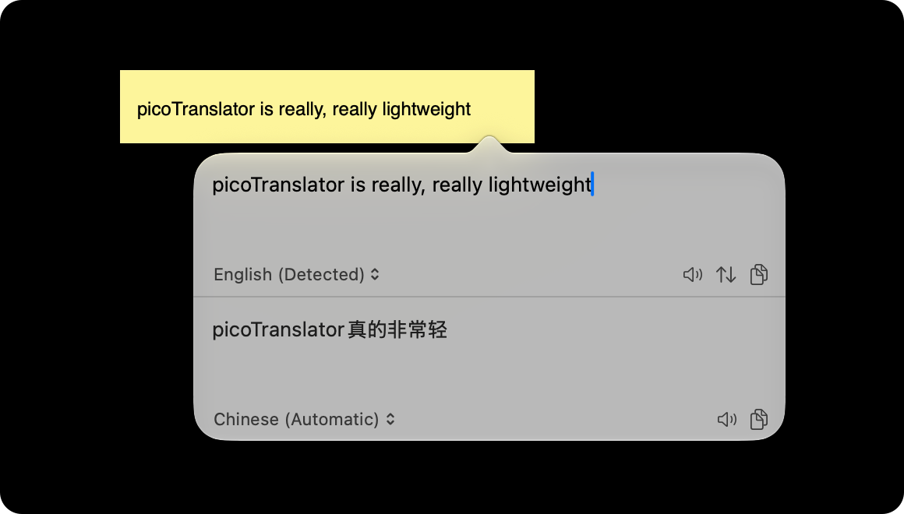

<p align="center">
  
</p>

<h1 align="center">picoTranslator</h1>

<p align="center">A tiny, no-frills translator for macOS.</p>

<p align="center">English · <a href="README.zh-CN.md">简体中文</a></p>

<p align="center">
  
</p>

## picoTranslator is really, really lightweight

- The app is smaller than its own icon!
- It should use about 50MB of memory while idle, and the code is ~1K lines of Swift with no dependencies.
- Everything is built on Apple's native frameworks. It's just a pure translator app, completely free.

## Features

- Select text anywhere on your screen, even in images or apps that don't let you copy it, and see the translation right next to your cursor.
- Open the translator to type or paste text yourself.

<p align="center">
  
</p>

## Install

Homebrew, the App Store and GitHub Releases are coming soon. Until then, build it from source.

Requires macOS 26 or later.

## Limitations and alternatives

Most of the code in this project was written with AI, and I built it for my own use. If you run into a bug, please [open an issue](https://github.com/encodeous/picoTranslator/issues).

picoTranslator is intentionally small in scope. If you need more, like dictionary lookups, many translation services, AI models or plugins, these are great options:

- [Easydict](https://github.com/tisfeng/Easydict): a free, open source macOS translator and dictionary that can compare results from many services, including AI ones.
- [Pot](https://github.com/pot-app/pot-desktop): a free, open source translator for macOS, Windows and Linux, with plugins for translation, text recognition and text-to-speech.

## Build

Needs the Xcode command line tools.

```bash
./build.sh
open build/picoTranslator.app
```

This makes a size-optimized release build in `build/picoTranslator.app`, signed with your Developer ID or Apple Development certificate if you have one, otherwise ad hoc. To choose the signing identity:

```bash
SIGN_ID="<identity>" ./build.sh
```

## License

[GNU Affero General Public License v3.0](LICENSE)
