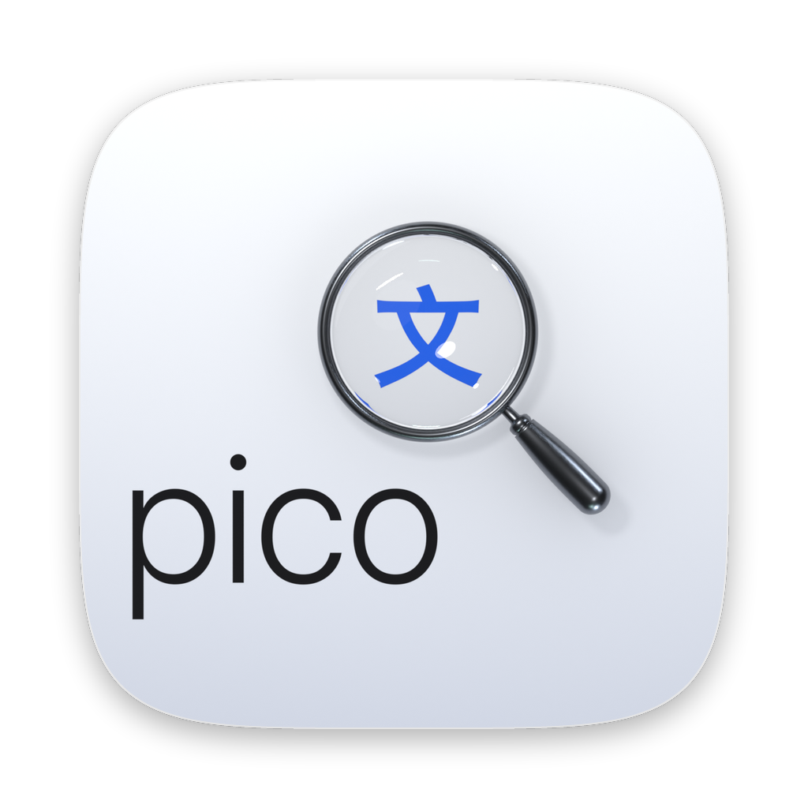
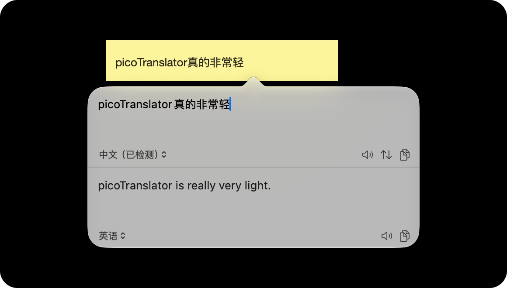
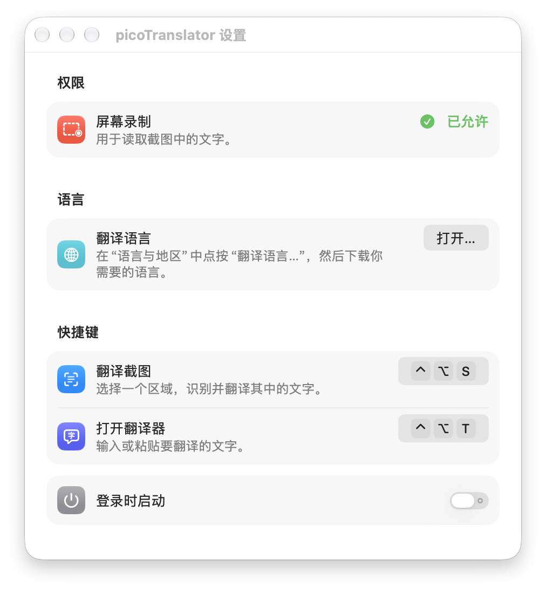

<p align="center">
  
</p>

<h1 align="center">picoTranslator</h1>

<p align="center">一款小巧、简洁的 macOS 翻译工具。</p>

<p align="center"><a href="README.md">English</a> · 简体中文</p>

<p align="center">
  
</p>

## picoTranslator 真的非常轻

- 应用本身比它的图标还小！
- 空闲时内存占用约 50MB，代码约 1000 行 Swift，没有任何依赖。
- 完全基于 Apple 的原生框架。它就是一个纯粹的翻译工具，完全免费。

## 功能

- 框选屏幕上任意位置的文字，即使是图片里的文字，或不允许拷贝的应用中的文字，译文都会显示在指针旁边。
- 打开翻译器，自己输入或粘贴文字。

<p align="center">
  
</p>

## 安装

Homebrew、App Store 和 GitHub Releases 即将推出。在此之前，请从源代码构建。

需要 macOS 26 或更高版本。

## 局限与替代方案

这个项目的大部分代码由 AI 编写，我做它是为了自己使用。如果你遇到问题，请[提交 issue](https://github.com/encodeous/picoTranslator/issues)。

picoTranslator 有意保持小巧。如果你需要更多功能，比如词典查询、多种翻译服务、AI 模型或插件，可以试试这些很棒的应用：

- [Easydict](https://github.com/tisfeng/Easydict)：免费、开源的 macOS 翻译和词典应用，可以对比包括 AI 在内的多种服务的结果。
- [Pot](https://github.com/pot-app/pot-desktop)：免费、开源的翻译应用，支持 macOS、Windows 和 Linux，提供翻译、文字识别和语音朗读插件。

## 构建

需要 Xcode 命令行工具。

```bash
./build.sh
open build/picoTranslator.app
```

这会在 `build/picoTranslator.app` 生成一个针对体积优化的发布版本。如果你有 Developer ID 或 Apple Development 证书，会用它签名，否则使用临时签名。要指定签名身份：

```bash
SIGN_ID="<identity>" ./build.sh
```

## 许可证

[GNU Affero 通用公共许可证 v3.0](LICENSE)
